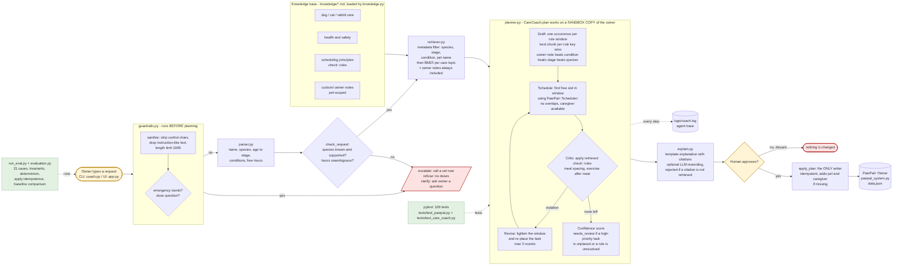
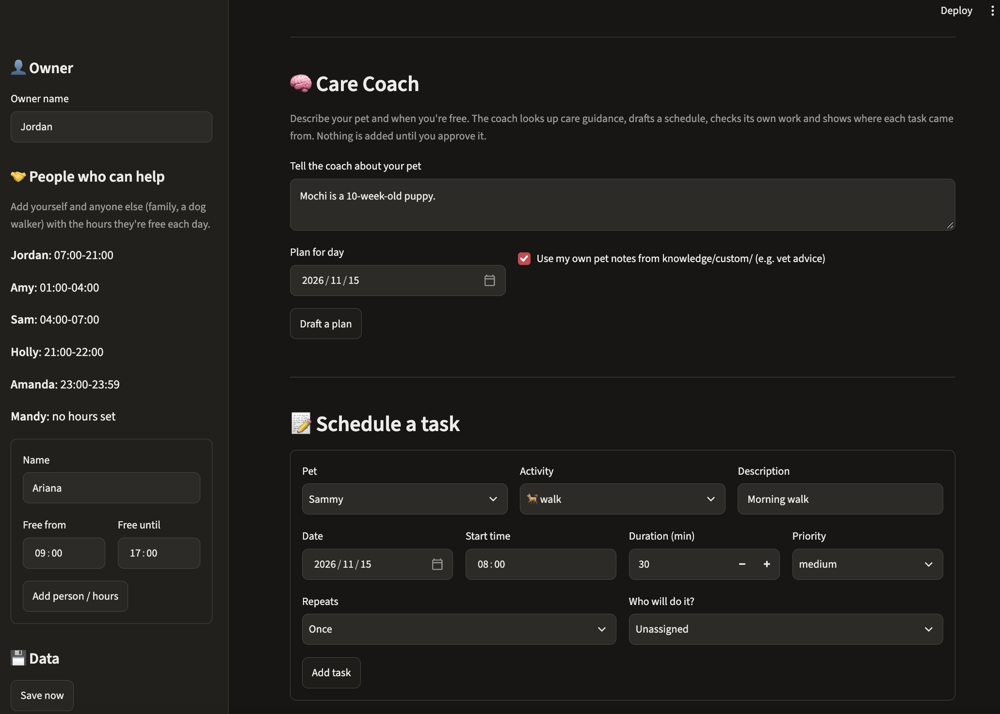
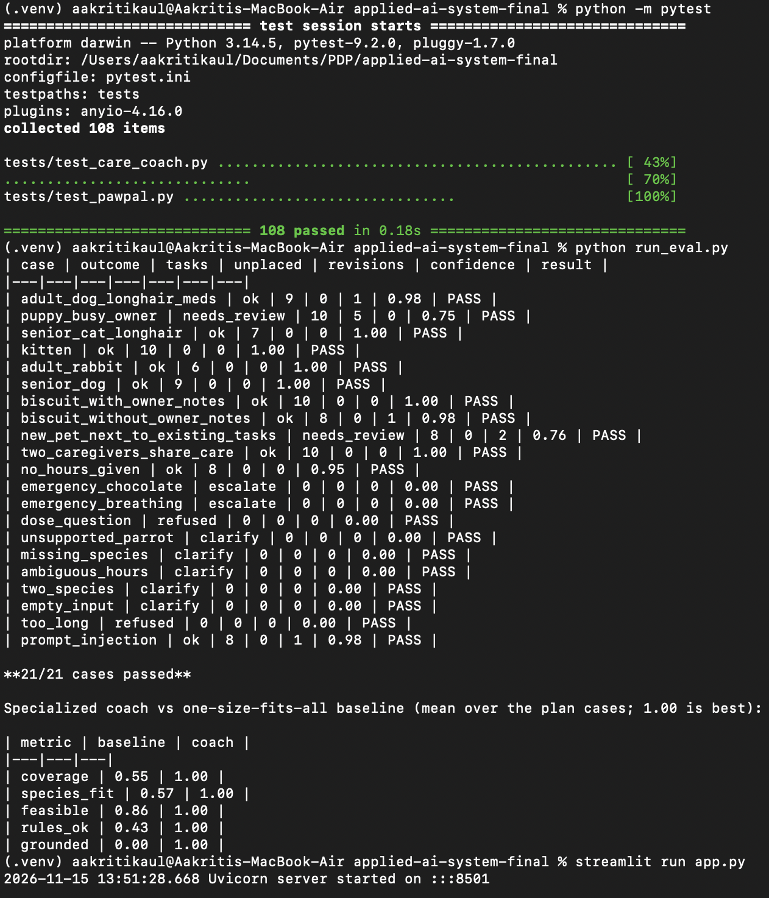

# 🐾 PawPal+ Care Coach (Project 4: Applied AI System)

## Base project

This extends **PawPal+ (Module 2)**, a pet-care scheduler. In Module 2 an owner adds pets, tasks (walks, meals, grooming,
play, meds) and caregivers with free hours; the `Scheduler` sorts and filters tasks, detects overlapping tasks, finds
who is free, creates recurring tasks, and saves everything to JSON. Its code is unchanged in `pawpal_system.py`
(the Module 2 write-ups are archived in [`docs/module2/`](docs/module2/)).

## What I added: the Care Coach

You describe a pet in plain English ("Mochi is a 10-week-old puppy. I'm only free 6-9am and after 6pm.") and the coach
returns a **cited, self-checked daily schedule** that you approve before anything is saved. It is one integrated feature
made of four parts that all feed the same output:

| Part | What it does | Where |
|---|---|---|
| **RAG (multi-source)** | Retrieves care guidance from 5 shared markdown documents plus *your own* notes (`knowledge/custom/`). Metadata filters (species, life stage, condition, pet name) then BM25 ranking pick the chunks; retrieved `task:` lines become the tasks and every task carries its source. | `care_coach/knowledge.py`, `retriever.py` |
| **Agentic workflow** | parse → guardrail → retrieve → draft → schedule → **critic** → revise (up to 3 rounds) → confidence score → human approval → apply. The critic applies `check:` rules that were themselves retrieved (meal spacing, no hard exercise right after a meal). Every step is logged. | `care_coach/planner.py` |
| **Reliability / guardrails** | Emergency escalation, "never invent doses", unsupported or ambiguous input asks a question, prompt-injection text is stripped, `plan()` never touches real data, `apply_plan()` is idempotent, confidence score flags plans that need review. | `care_coach/guardrails.py` |
| **Specialization + evaluation** | Behaviour is specialised by species, stage, condition and pet. `run_eval.py` runs 21 scripted cases, invariants, determinism, and a baseline comparison. | `eval/cases.json`, `run_eval.py` |

No generative model is used in any of the evidence below: the pipeline is deterministic and runs offline. An optional
Claude wrapper that only rewords the explanation exists (`--llm`), is off by default, and falls back to the template
if it cites anything that was not retrieved (see Limitations).

## Architecture



Source: [`diagrams/architecture.mmd`](diagrams/architecture.mmd). Data flows left to right: the owner's text passes the
**input guardrails**, is parsed, passes the **request checks**, then retrieval feeds the agent loop (draft, schedule with
the real PawPal+ `Scheduler`, critic, revise). Two checkpoints involve a person: the owner approves the plan, and the
guardrails can send the owner back with a question. Testing (pytest, `run_eval.py`) is shown dashed.

## Setup

Python 3.10+ (built on 3.12; also run on 3.14.5 / macOS). From the project folder:

```bash
python3 -m venv .venv
source .venv/bin/activate            # Windows: .venv\Scripts\activate
pip install -r requirements.txt

python -m pytest                     # 108 tests (32 from Module 2 + 76 for the coach)
python run_eval.py                   # 21-case evaluation + baseline comparison
python coach.py --demo               # four example requests, no setup needed
python coach.py "Luna is a 4 year old dog. I'm free 07:00-21:00." --trace --explain
streamlit run app.py                 # the UI, with the Care Coach section
python scripts/generate_evidence.py  # regenerate logs/agent_traces.md etc.
```

Useful flags: `--no-custom` (ignore your own notes), `--day 2026-01-05`, `--data data.json --apply` (asks before
saving; `--yes` skips the question), `--llm` (optional, needs `pip install -r requirements-llm.txt` and `ANTHROPIC_API_KEY`).

**The app.** `streamlit run app.py` adds a **Care Coach** section above "Schedule a task": type a description, click
*Draft a plan*, review the cited plan, then *Approve* or *Discard*. All the Module 2 features are still there.



## Sample interactions (real output, `--day 2026-01-05`)

**1. A normal request where the critic revises the draft**

`python coach.py "Luna is a 4 year old long-haired dog on medication. I'm free 07:00-21:00." --day 2026-01-05`

```text
PLAN for Luna (dog, adult) on Monday 2026-01-05   confidence 0.98  status: OK
  TIME         TASK                                         WHO         SOURCE
  07:00-07:15  Adult dog meal                               You         dog_care.md > Adult dog feeding
  07:45-07:50  Refresh water bowl                           You         dog_care.md > Adult dog water
  08:00-08:05  Give prescribed medication (follow the vet's You         health_and_safety.md > Medication reminders
  08:15-08:45  Walk                                         You         dog_care.md > Adult dog walks
  12:00-12:30  Bath day (repeat every four to eight weeks i You         dog_care.md > Adult dog grooming and baths
  17:00-17:30  Walk                                         You         dog_care.md > Adult dog walks
  17:30-17:45  Adult dog meal                               You         dog_care.md > Adult dog feeding
  18:00-18:15  Daily brushing (long coat)                   You         dog_care.md > Long-haired dog brushing
  18:45-19:05  Play or fetch session                        You         dog_care.md > Adult dog play
  critic: 1 revision round(s)
    - round 1: 'Play or fetch session' at 18:30 starts 45 min after the 17:30 meal (wait 60) -> moved
    - round 1: 'Walk' at 07:15 starts 0 min after the 07:00 meal (wait 60) -> moved
```

The first draft put a walk 0 minutes after the 07:00 meal and play 45 minutes after the 17:30 meal. The critic, using
the retrieved rule "avoid longer walks and energetic play for about an hour after a meal", moved both. The bath and
meds items cite their own documents.

**2. A busy owner: the coach says what it could not do instead of faking it**

`python coach.py "I just adopted a 10-week-old puppy named Mochi. I work 9-5, so I'm only free 6-9am and after 6pm." --day 2026-01-05`

```text
PLAN for Mochi (dog, baby) on Monday 2026-01-05   confidence 0.75  status: NEEDS_REVIEW
  TIME         TASK                                         WHO         SOURCE
  07:00-07:15  Puppy meal                                   You         dog_care.md > Puppy feeding
  07:15-07:20  Refresh water bowl                           You         dog_care.md > Puppy water
  08:30-08:45  Short walk and potty break                   You         dog_care.md > Puppy potty and walk breaks
  18:00-18:15  Puppy meal                                   You         dog_care.md > Puppy feeding
  19:00-19:15  Short walk and potty break                   You         dog_care.md > Puppy potty and walk breaks
  --:--        Gentle brushing and paw handling             NOT PLACED   nobody is free 16:00-18:00 for 10 min (consider asking a family member or a walker to cover this one)
  --:--        Puppy meal                                   NOT PLACED   nobody is free 12:00-13:30 for 15 min (consider asking a family member or a walker to cover this one)
  --:--        Play and short training session              NOT PLACED   nobody is free 10:30-12:00 for 20 min (consider asking a family member or a walker to cover this one)
  --:--        Play and short training session              NOT PLACED   nobody is free 16:00-17:30 for 20 min (consider asking a family member or a walker to cover this one)
  --:--        Short walk and potty break                   NOT PLACED   nobody is free 14:00-15:30 for 15 min (consider asking a family member or a walker to cover this one)
  critic: 0 revision round(s)
  tip: Give each task to a person who is actually free at that time, and avoid booking one person for two things at once. (scheduling_principles.md > Share care across people)
```

Note "I work 9-5" was *not* read as free time. Five tasks (including a midday puppy meal) have no caregiver, so the plan
is marked `NEEDS_REVIEW` and cites the "share care across people" guidance.

**3. An emergency: the guardrail stops the agent before it plans**

`python coach.py "My dog just ate a bar of chocolate, can you schedule his care?"`

```text
[ESCALATE] This sounds like it could be an emergency. Please contact a veterinarian or an emergency animal hospital right now instead of using a care schedule. In the United States, ASPCA Animal Poison Control is (888) 426-4435 and the Pet Poison Helpline is (855) 764-7661 (fees may apply; check the number before relying on it). PawPal+ Care Coach can build a routine once your pet is safe.
```

More guardrail inputs and outputs (doses, unsupported species, ambiguous hours, prompt injection, empty input) are in
[`logs/guardrail_examples.md`](logs/guardrail_examples.md); full agent traces are in
[`logs/agent_traces.md`](logs/agent_traces.md) and [`ai_interactions.md`](ai_interactions.md).

## RAG enhancement: custom documents, before and after

`knowledge/custom/biscuit_notes.md` is a (fictional) note of vet advice for one dog, Biscuit: leash-only short walks and
indoor play. It is scoped with `pet=Biscuit` so it only applies to that dog, and because it is explicit owner input it is
always retrieved and outranks generic guidance.

**Before** (`python coach.py "Biscuit is a 3 year old dog. I'm free 07:00-21:00." --no-custom`)

```text
PLAN for Biscuit (dog, adult) on Monday 2026-01-05   confidence 0.98  status: OK
  TIME         TASK                                         WHO         SOURCE
  07:00-07:15  Adult dog meal                               You         dog_care.md > Adult dog feeding
  07:45-07:50  Refresh water bowl                           You         dog_care.md > Adult dog water
  08:15-08:45  Walk                                         You         dog_care.md > Adult dog walks
  10:00-10:15  Brush coat and check ears and nails          You         dog_care.md > Adult dog grooming and baths
  12:00-12:30  Bath day (repeat every four to eight weeks i You         dog_care.md > Adult dog grooming and baths
  17:00-17:30  Walk                                         You         dog_care.md > Adult dog walks
  17:30-17:45  Adult dog meal                               You         dog_care.md > Adult dog feeding
  18:45-19:05  Play or fetch session                        You         dog_care.md > Adult dog play
  critic: 1 revision round(s)
    - round 1: 'Play or fetch session' at 18:30 starts 45 min after the 17:30 meal (wait 60) -> moved
    - round 1: 'Walk' at 07:15 starts 0 min after the 07:00 meal (wait 60) -> moved
```

**After** (same command without `--no-custom`)

```text
PLAN for Biscuit (dog, adult) on Monday 2026-01-05   confidence 1.00  status: OK
  TIME         TASK                                         WHO         SOURCE
  07:00-07:15  Adult dog meal                               You         dog_care.md > Adult dog feeding
  07:15-07:20  Refresh water bowl                           You         dog_care.md > Adult dog water
  08:30-08:40  Leash-only walk and potty break (vet advice) You         biscuit_notes.md > Biscuit: notes from the vet visit
  10:00-10:15  Brush coat and check ears and nails          You         dog_care.md > Adult dog grooming and baths
  10:30-10:45  Indoor play at home only (vet advice)        You         biscuit_notes.md > Biscuit: notes from the vet visit
  12:00-12:30  Bath day (repeat every four to eight weeks i You         dog_care.md > Adult dog grooming and baths
  14:00-14:10  Leash-only walk and potty break (vet advice) You         biscuit_notes.md > Biscuit: notes from the vet visit
  16:00-16:15  Indoor play at home only (vet advice)        You         biscuit_notes.md > Biscuit: notes from the vet visit
  17:30-17:45  Adult dog meal                               You         dog_care.md > Adult dog feeding
  19:00-19:10  Leash-only walk and potty break (vet advice) You         biscuit_notes.md > Biscuit: notes from the vet visit
  critic: 0 revision round(s)
```

Walks became short leash-only breaks and play moved indoors, each citing `biscuit_notes.md`. The same request for a dog
named Rex is unchanged. Measured in the eval (`biscuit_with_owner_notes` vs `biscuit_without_owner_notes`).

## Testing summary

**pytest** (my own run on macOS, Python 3.14.5, pytest 9.2.0; abridged):

```text
$ python -m pytest
collected 108 items

tests/test_care_coach.py ........................................... [ 43%]
...............................                                       [ 70%]
tests/test_pawpal.py ................................                 [100%]

============================== 108 passed in 0.18s ==============================
```



**Evaluation harness** (`python run_eval.py`, also saved to `logs/eval_results.md` and `.json`; exit code 1 on any failure):

| case | outcome | tasks | unplaced | revisions | confidence | result |
|---|---|---|---|---|---|---|
| adult_dog_longhair_meds | ok | 9 | 0 | 1 | 0.98 | PASS |
| puppy_busy_owner | needs_review | 10 | 5 | 0 | 0.75 | PASS |
| senior_cat_longhair | ok | 7 | 0 | 0 | 1.00 | PASS |
| kitten | ok | 10 | 0 | 0 | 1.00 | PASS |
| adult_rabbit | ok | 6 | 0 | 0 | 1.00 | PASS |
| senior_dog | ok | 9 | 0 | 0 | 1.00 | PASS |
| biscuit_with_owner_notes | ok | 10 | 0 | 0 | 1.00 | PASS |
| biscuit_without_owner_notes | ok | 8 | 0 | 1 | 0.98 | PASS |
| new_pet_next_to_existing_tasks | needs_review | 8 | 0 | 2 | 0.76 | PASS |
| two_caregivers_share_care | ok | 10 | 0 | 0 | 1.00 | PASS |
| no_hours_given | ok | 8 | 0 | 0 | 0.95 | PASS |
| emergency_chocolate | escalate | 0 | 0 | 0 | 0.00 | PASS |
| emergency_breathing | escalate | 0 | 0 | 0 | 0.00 | PASS |
| dose_question | refused | 0 | 0 | 0 | 0.00 | PASS |
| unsupported_parrot | clarify | 0 | 0 | 0 | 0.00 | PASS |
| missing_species | clarify | 0 | 0 | 0 | 0.00 | PASS |
| ambiguous_hours | clarify | 0 | 0 | 0 | 0.00 | PASS |
| two_species | clarify | 0 | 0 | 0 | 0.00 | PASS |
| empty_input | clarify | 0 | 0 | 0 | 0.00 | PASS |
| too_long | refused | 0 | 0 | 0 | 0.00 | PASS |
| prompt_injection | ok | 8 | 0 | 1 | 0.98 | PASS |

**21/21 cases passed**

Specialized coach vs one-size-fits-all baseline (mean over the plan cases; 1.00 is best):

| metric | baseline | coach |
|---|---|---|
| coverage | 0.55 | 1.00 |
| species_fit | 0.57 | 1.00 |
| feasible | 0.86 | 1.00 |
| rules_ok | 0.43 | 1.00 |
| grounded | 0.00 | 1.00 |


What the harness checks for *every* plan: no overlaps (including with existing tasks), every task inside caregiver
hours and inside its rule window, every task cites a real knowledge chunk, `ok` status never carries a broken rule,
the plan is deterministic, `plan()` does not change the owner's data, and applying a plan twice adds nothing the second time.

**Does the harness catch bugs?** I broke the code on purpose, one change at a time, and ran `run_eval.py`:
disabling the critic (3 cases failed), ignoring caregiver hours (2 failed), ignoring existing tasks (1 failed),
turning off the emergency guardrail (2 failed), removing the life-stage filter (1 failed). Each was reverted afterwards.
The weakest result is the last one: only one case caught it, because the stage word in the search query also steers
retrieval toward the right stage (defence in depth), so that filter is less independently tested than the others.

**Confidence scores:** adult dog with medication 0.98 (ok); puppy with a busy owner 0.75 (needs review); rabbit 1.00.
The score is a hand-made heuristic (penalties for unplaced tasks, unresolved rule breaks, guessed inputs), not a calibrated probability.

## Design decisions and trade-offs

- **Offline retrieval instead of an LLM.** BM25 over a small curated knowledge base is reproducible, free, and every
  claim has a source. The cost: it only knows what is in `knowledge/`, and it cannot understand free-form phrasing the
  parser does not expect.
- **Rules live in the documents.** A `task:` or `check:` line sits next to the prose that justifies it, so changing the
  guidance changes the plan with no code change, and a malformed rule fails loudly at load time.
- **Metadata filtering does most of the species/stage work; BM25 decides which topic chunks are relevant.** Removing the
  stage filter changed results in only one eval case (see Testing), so I do not claim retrieval alone is "smart".
- **Sandbox + approval.** `plan()` works on a copy and returns a proposal; only `apply_plan()` writes, and the UI needs a click.
- **Report gaps instead of hiding them.** If no caregiver is free, the task is listed as not placed with a reason.
- **The critic only enforces rules that are written in the knowledge base.** (I removed an extra "exercise before meals"
  check I had added because the document did not say it.)

## Limitations (more in [`model_card.md`](model_card.md))

- Care guidance is general, written for this project from common pet-care knowledge, and is **not veterinary advice**. Check it
  with your vet, especially for puppies, seniors and sick pets.
- Only dogs, cats and rabbits; one pet per request; one day at a time.
- Hours must be written with am/pm or 24-hour times; "free evenings" is not understood.
- The optional `--llm` explainer was only tested with a fake client, never against the live API.
- The baseline is a deliberately simple one-size-fits-all routine, so "coach beats baseline" shows the value of
  specialisation, not that this beats a human or a real LLM.

## Reflection

The biggest lesson was that the trustworthy part of an AI feature is mostly the code around the "smart" step: the
guardrails, the critic, the sandbox and the tests. The first demo run planned a normal day for a dog that had just
eaten chocolate because my emergency pattern only matched "ate chocolate" and not "ate a bar of chocolate"; a parser
test later caught work hours being treated as free hours. Both were invisible until I wrote realistic inputs, which is
why the evaluation cases include phrasing variants and why I broke the code on purpose to confirm the tests can fail.

## Project structure

```
app.py, main.py, pawpal_system.py   PawPal+ UI, Module 2 demo, scheduling logic (Module 2)
coach.py                            Care Coach command line
care_coach/                         knowledge, retriever, parser, guardrails, planner (agent), explain, evaluation
knowledge/                          5 shared documents + custom/biscuit_notes.md (fictional owner note)
eval/cases.json, run_eval.py        21 evaluation cases and the runner
tests/                              test_pawpal.py (Module 2) + test_care_coach.py
diagrams/architecture.mmd           architecture source;  assets/architecture.png  rendered image
logs/                               agent_traces.md, rag_before_after.md, guardrail_examples.md, eval_results.*
scripts/                            generate_evidence.py, smoke_test_app.py (mock-Streamlit check of app.py)
model_card.md, ai_interactions.md   reflection, AI collaboration log
docs/module2/                       the original Module 2 README, reflection and AI log
```

## Stretch features implemented

RAG enhancement (custom pet-scoped documents + multi-source retrieval, before/after above) · agentic workflow with
traces ([`logs/agent_traces.md`](logs/agent_traces.md)) · specialization with a measured baseline comparison
([`model_card.md`](model_card.md)) · evaluation harness (`run_eval.py`).
